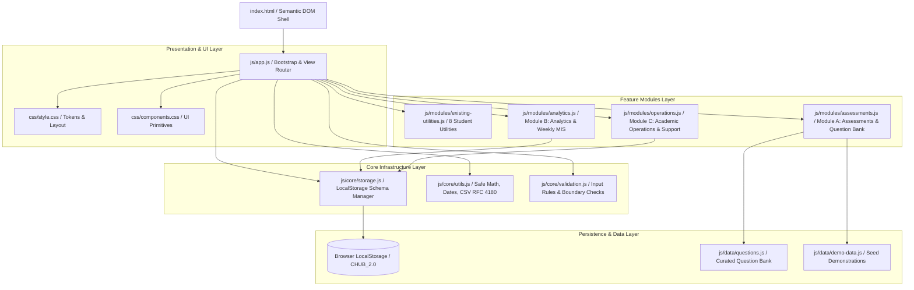

# Campus Utility Hub 2.0

> A clean, modular, and responsive student learning, programming assessment, and academic operations platform built with semantic HTML5, CSS3, and vanilla ES modules.

[](LICENSE)
[]()
[-success.svg)]()
[]()

---

## 1. Project Overview & Objective

**Campus Utility Hub 2.0** is an upgraded academic operations and technical assessment platform. Originally a collection of disjointed student utilities, version 2.0 refactors the codebase into a modular, production-minded architecture tailored for college engineering chapters, academic coordinators, and technical team associates (such as the **CodeChef College Team Associate** role).

The platform addresses two complementary campus needs:
1. **Student Academic Productivity**: Daily utilities including session-based attendance tracking, weighted credit SGPA calculation, and typing metrics.
2. **Assessment & Operations Management**: A structured programming question bank, timed diagnostics, cohort analytics with weekly MIS reporting, and an operational issue tracker for computer lab infrastructure.

---

## 2. System Architecture

The application adopts a small-footprint, zero-build architectural model using native browser ES modules (`type="module"`), separation of concerns, and centralized state persistence.



---

## 3. Directory Structure

```text
CAMPUS UTILITY HUB/
├── index.html                   # Semantic HTML5 shell with 4 top-level module views
├── README.md                    # Comprehensive technical documentation & setup guide
├── css/
│   ├── style.css                # Design tokens, CSS variables, dark mode, responsive layout
│   └── components.css           # Modular UI primitives: cards, tables, badges, modals, toasts
├── js/
│   ├── app.js                   # Application bootstrap, navigation router, factory reset
│   ├── core/
│   │   ├── storage.js           # Centralized schema-versioned LocalStorage manager (CHUB_v2)
│   │   ├── utils.js             # Pure helpers: dates, zero-safe percentage, RFC 4180 CSV, toasts
│   │   └── validation.js        # Reusable input validation for forms, questions, and tickets
│   ├── data/
│   │   ├── questions.js         # Curated question bank (Arrays, Strings, Sorting, Searching, DSA)
│   │   └── demo-data.js         # Realistic fictional seed data for attempts, tickets, schedules
│   └── modules/
│       ├── existing-utilities.js # Refactored, persistent implementations of the 8 utilities
│       ├── assessments.js       # Module A: Question bank CRUD & timed assessment runner
│       ├── analytics.js         # Module B: Derived metrics, CSV export, printable Weekly MIS
│       └── operations.js        # Module C: Support ticket tracker, overdue SLA, schedule calendar
└── tests/
    ├── index.html               # Interactive in-browser unit test runner UI
    ├── run_all.py               # Standalone Python CLI test runner for automated verification
    ├── verify_ids.py            # Automated script validating 100% of DOM element bindings
    ├── utilities.test.js        # Unit tests for attendance, CGPA, and conversion logic
    ├── assessments.test.js      # Unit tests for question scoring, validation, and thresholds
    ├── analytics.test.js        # Unit tests for derived metrics and CSV RFC 4180 escaping
    └── operations.test.js       # Unit tests for ticket status, SLA overdue logic, and KPIs
```

---

## 4. Core Capabilities & Module Breakdown

### Module A: Programming Assessment Management
- **Structured Question Bank**: Organizes algorithmic challenges by Topic (*Arrays, Strings, Sorting, Searching, Basic Data Structures*) and Difficulty (*Easy, Medium, Hard*).
- **Question Details & CRUD**: Create, edit, inspect, and delete questions with full constraints, sample inputs, sample outputs, explanations, and reference solutions.
- **Timed Diagnostic Runner**: Timed multiple-choice assessments with live countdown timer, unanswered question badge, and interactive question palette.
- **Answer Navigation**: Candidates can navigate freely between questions and change selections prior to submission.
- **Timeout & Submission Protection**: Handles timer expiration automatically and prevents accidental duplicate submissions.
- **Detailed Solution Review**: Immediately reveals accuracy score, pass/fail status, user choices vs. correct answers, detailed explanations, and reference solution code.

> **Scope Distinction**: This module is a programming assessment management and multiple-choice algorithmic evaluation platform. It does not execute arbitrary untrusted student code directly in the browser; safe execution of arbitrary code requires an isolated backend container sandbox.

### Module B: Assessment Analytics & Weekly MIS
- **Derived Metrics Engine**: Calculates total assessments, attempts, completed vs. pending attempts, cohort average score, and completion rate from stored data without hardcoding.
- **Division-by-Zero Resilience**: Handles empty datasets and edge cases gracefully without returning `NaN`.
- **Topic-Wise Performance**: Aggregates attempt counts and average accuracy per algorithmic topic with visual proficiency tags.
- **Date & Assessment Filtering**: Filter attempt logs by specific assessment or date ranges.
- **RFC 4180 CSV Export**: Generates client-side CSV downloads safely escaping commas, double quotes, and newlines.
- **Printable Weekly MIS Report**: Formatted executive report with audit metadata, key performance indicators, topic breakdowns, and signature lines, styled for browser printing (`@media print`).

### Module C: Academic Operations & Support Tracker
- **Support Issue Management**: Create, edit, filter, and resolve technical tickets across categories: *Lab Infrastructure, Assessment Platform, Grading & Evaluation, Student Query, Administrative*.
- **SLA & Overdue Highlighting**: Detects overdue tickets based on due date relative to today's date and highlights them in high-contrast red alerts.
- **Real-Time Operational KPIs**: Live counts of active queue, overdue items, high-priority issues, and resolved tasks.
- **Assessment Schedules & Deadlines**: Track upcoming midterm exams, chapter contests, and lab sessions with venue and target cohort tags.
- **College Review Digest**: Summary briefing prepared for department heads and faculty reviews.

### Preserved & Upgraded Academic Utilities
1. **Smart Attendance Tracker**: Session history tracking (attended vs. total sessions) with 75% university eligibility status badges and LocalStorage persistence.
2. **CGPA & SGPA Calculator**: Itemized course list with credits and official grade points (O:10, A+:9, A:8, B+:7, B:6, C:5, F:0), guarded against zero-credit division.
3. **Number Systems Converter**: Base conversions between Decimal, Binary, Octal, and Hexadecimal, as well as Binary to Decimal, with boundary validation.
4. **Password Security Analyzer**: Real-time evaluation with dynamic meter coloring and a 5-point criteria checklist.
5. **Interactive Concept Quiz**: Fixed multiple-choice quiz with option lockout, Next button handling, and score card.
6. **Shared Expense Splitter**: Itemized cost tracking, participant counts, and per-person equal share breakdown.
7. **UI Theme Customizer**: Dynamic font-size and card-radius sliders, dark mode toggle, and persistent settings in LocalStorage.
8. **Typing Speed Tester**: Real-time keystroke tracking with words-per-minute (WPM), character accuracy percentage, and test restart.

---

## 5. Metric Formulas & Scoring Rules

| Metric | Formula | Edge Case / Handling |
| :--- | :--- | :--- |
| **Attendance %** | `(Attended Sessions / Total Sessions) * 100` | Returns `0%` if `Total Sessions <= 0`. Flagged as shortage if `< 75%`. |
| **SGPA (Weighted)** | `Sum(Credits * GradePoints) / Sum(Credits)` | Returns `0.00` if `Total Credits <= 0`. |
| **Assessment Score** | `(Correct Answers / Total Questions) * 100` | Rounded to 1 decimal place. |
| **Completion Rate** | `(Completed Attempts / Total Registered Attempts) * 100` | Unassigned or unattempted assessments are not counted as completed. Returns `0%` if 0 attempts. |
| **Cohort Average Score** | `Sum(Scores of Completed Attempts) / Count(Completed Attempts)` | Incomplete/abandoned attempts do not pollute the score denominator. Returns `0%` if no completed attempts exist. |
| **Overdue Detection** | `DueDate < Today && Status !== 'Resolved'` | Ignores time component; resolved tickets are never marked overdue. |

---

## 6. Local Setup and Execution

Because Campus Utility Hub 2.0 utilizes native browser **ES Modules** (`import` / `export`), it must be served over an HTTP server rather than loaded through the `file://` protocol.

### Prerequisites
- Python 3.x (already installed on standard developer machines) **OR** any local static file server.

### Running Locally
1. Clone the repository:
   ```bash
   git clone https://github.com/soumyadip-das-dev/CAMPUS-UTILITY-HUB.git
   cd CAMPUS-UTILITY-HUB
   ```
2. Start the local server:
   ```bash
   python -m http.server 3000
   ```
3. Open your browser and navigate to:
   ```text
   http://localhost:3000
   ```

---

## 7. Testing Instructions & Results

The project features a dual testing strategy verifying business logic, boundary conditions, and DOM element consistency:

### 1. In-Browser Interactive Test Runner
Navigate to `http://localhost:3000/tests/` while the local server is running. This executes all unit test suites natively in the browser with full ES module support:
- `tests/utilities.test.js`: Attendance percentages, SGPA weighted math, number conversions, password entropy.
- `tests/assessments.test.js`: Question validation, MCQ scoring, boundary percentage calculations.
- `tests/analytics.test.js`: Derived metrics, empty dataset division-by-zero resilience, RFC 4180 CSV escaping.
- `tests/operations.test.js`: Ticket validation, SLA overdue calculations, operational summary counts.

### 2. Standalone CLI Test Runner
Run the automated test suite directly from your terminal:
```bash
python tests/run_all.py
```

**Verified Test Results**:
```text
=================================================================
 Campus Utility Hub 2.0 - Automated Logic & Edge Cases Test Suite
=================================================================
[Suite 1: Safe Math & Utility Calculations] -> 4/4 Passed
[Suite 2: CGPA & SGPA Weighted Scoring]    -> 3/3 Passed
[Suite 3: RFC 4180 CSV Escaping]           -> 5/5 Passed
[Suite 4: Overdue Date & SLA Tracking]     -> 4/4 Passed
[Suite 5: Module B Analytics Derived]      -> 8/8 Passed
=================================================================
 Test Results: 24 passed, 0 failed, 24 total assertions.
=================================================================
```

### 3. DOM Integrity Verification
```bash
python tests/verify_ids.py
# Verified: Checked 41 element IDs. 100% exist in index.html.
```

---

## 8. Deployment Instructions (GitHub Pages)

Campus Utility Hub 2.0 is 100% static and requires zero build steps, making it immediately deployable to **GitHub Pages**:

1. Push all code to the `main` branch of your repository.
2. In your GitHub repository, navigate to **Settings** > **Pages** (in the left sidebar).
3. Under **Build and deployment**:
   - **Source**: Select `Deploy from a branch`.
   - **Branch**: Select `main` and folder `/ (root)`.
4. Click **Save**.
5. Within 1–2 minutes, GitHub Pages will deploy your site at:
   `https://<your-username>.github.io/CAMPUS-UTILITY-HUB/`

---

## 9. Security, Limitations & Trade-Offs

- **Client-Side Persistence**: Data is persisted in browser `LocalStorage`. This means data is browser-specific and will not synchronize across different devices or separate user logins.
- **Demonstration Scope**: The preloaded data is fictional and clearly labeled as demonstration data.
- **Absence of Code Execution Sandbox**: Multiple-choice problem diagnostics assess algorithmic understanding, complexity analysis, and pattern recognition. Arbitrary student C++ or Python code execution is intentionally omitted because client-side execution is insecure and server-side compilation requires an isolated Linux container sandbox (e.g., Docker/gVisor).

---

## 10. Future Roadmap

- [ ] Node.js / Express REST API backend with MongoDB multi-tenant persistence.
- [ ] Containerized code compilation sandbox using Docker and Judge0 API for running arbitrary test suites.
- [ ] Role-Based Access Control (RBAC) distinguishing Student, Faculty Evaluator, and Lab Administrator roles.
- [ ] Automated CodeChef College Chapter leaderboard integration via public competitive programming APIs.

---

## 11. Interview Guide & Resume Highlights

### Key Architectural Talking Points
- **Why Vanilla ES Modules over React for this project?**
  *Eliminated build-step overhead, reduced bundle size to near-zero, ensured instant load times, and demonstrated deep proficiency in core JavaScript, DOM manipulation, and browser APIs.*
- **How was state persistence architected?**
  *Implemented a centralized storage wrapper (`storage.js`) with schema versioning (`CHUB_2.0.0`), fallback defaults, and automated migration logic.*
- **How are calculation edge cases safeguarded?**
  *All percentage calculations utilize `safePercentage()` to prevent `NaN` or `Infinity` from zero denominators. Attendance and analytics formulas explicitly define their denominators.*

### Resume-Ready Project Bullets
- **Architected and implemented Campus Utility Hub 2.0**, a modular academic operations and assessment platform using Vanilla ES6 modules, semantic HTML5, and responsive CSS3.
- **Engineered a timed programming assessment engine and question bank** covering 5 core data structure topics with automated scoring, countdown timers, solution explanations, and post-test review modes.
- **Built an institutional assessment analytics dashboard and support ticketing workflow**, featuring RFC 4180-compliant CSV exports, printable weekly MIS reports, and automated SLA overdue detection backed by an automated 24-assertion test suite.
